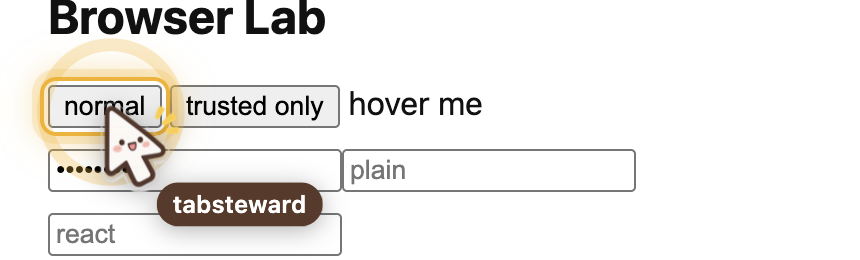
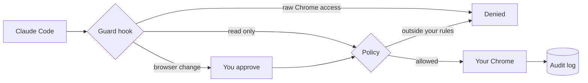

<p align="center">
  
</p>

<h1 align="center">tabsteward</h1>

<p align="center">
  <strong>Let Claude Code work in your real, logged-in Chrome, inside rules you set.</strong>
</p>

<p align="center">
  <a href="https://github.com/tms-vunguyen1/tabsteward/releases/latest"></a>
  
  
  
  <a href="LICENSE"></a>
</p>

<p align="center">
  <a href="#quick-start">Quick start</a> ·
  <a href="#how-you-stay-in-control">How you stay in control</a> ·
  <a href="#commands">Commands</a> ·
  <a href="#limitations">Limitations</a>
</p>

<p align="center">
  
</p>

## Why tabsteward

Browser automation usually starts a separate browser that knows nothing about you. tabsteward works in the Chrome you already have open, with your sessions, and needs no extension or debug port.

That access is powerful, so nothing runs until you choose what is allowed. You pick the profiles and sites, and you approve every change to the browser.

- **Your real browser.** Open tabs, read pages, click and fill forms in the windows you already use.
- **Default deny.** No policy means no access, and profiles you did not allow stay out of reach.
- **Human approval.** Every click, fill, navigation and tab close asks you first.
- **A visible cursor.** Ask to watch and a labelled cursor shows what is about to be clicked.
- **An audit trail.** Every attempted change is logged locally, without the text you typed.
- **No dependencies.** It only needs Python's standard library and macOS AppleScript.

## Quick start

**Requirements:** macOS, Google Chrome, Python 3 and [Claude Code](https://claude.com/claude-code).

**1. Install the plugin**

```sh
claude plugin marketplace add tms-vunguyen1/tabsteward
claude plugin install tabsteward@tabsteward
```

**2. Choose what Claude may touch**

Claude starts setup the first time you ask for something in your browser, or you can run it yourself:

```text
/tabsteward:setup
```

Setup lists the Chrome profiles on your machine, then asks which ones Claude may use, whether to limit it to specific sites, and whether to allow arbitrary JavaScript. You approve the result in a prompt.

**3. Allow scripting in Chrome**

In each chosen profile, enable **View > Developer > Allow JavaScript from Apple Events** in the macOS menu bar.

> [!WARNING]
> This setting lets any local script run JavaScript in that profile's tabs, logged-in sites included. Turn it off when you are not using it.

**4. Ask for something**

```text
Open a new tab in my Personal profile and search X for "AI"
```

## How you stay in control



| Layer | What it does |
|---|---|
| **Policy** | Limits which profiles and domains are reachable, and whether arbitrary JavaScript runs. Only `http(s)` pages are allowed. |
| **Guard hook** | Blocks raw `osascript`, the Chrome binary and Chrome's data folder. Protects the policy, and asks you before each browser change. |
| **Audit log** | Records each attempted change and its outcome in `~/.config/tabsteward/audit.jsonl`. |
| **Credentials rule** | `fill` refuses password fields, and `read` masks their values. |

Claude can start setup only when no policy exists. To change an existing policy, type `/tabsteward:setup` yourself, so Claude cannot widen its own access after a refusal.

### Policy file

Setup writes `~/.config/tabsteward/policy.json`, which stays on your machine. You can also edit it by hand:

```json
{
  "profiles": ["Profile 3"],
  "allow_js": false,
  "allow_domains": ["example.com"]
}
```

| Key | Meaning |
|---|---|
| `profiles` | Profile folders Claude may touch, listed in `chrome://version` under "Profile Path". |
| `allow_js` | Whether arbitrary JavaScript may run. Leave this off unless you need it. |
| `allow_domains` | Allowed sites. `example.com` also covers subdomains. Empty means any web domain. |

## Commands

Claude runs these for you through the skill.

| Command | Purpose | Asks first |
|---|---|---|
| `profiles` | List allowed profiles | No |
| `windows [--profile NAME]` | List windows and tabs | No |
| `read TAB [--selector S]` | Read page text and interactive elements | No |
| `wait TAB SELECTOR` | Wait for an element | No |
| `open URL --profile NAME` | Open a tab in an existing window | Yes |
| `goto TAB URL` | Navigate a tab | Yes |
| `activate TAB` | Bring a tab forward | Yes |
| `click TAB SELECTOR [--expect T] [--within S] [--cursor]` | Click an element | Yes |
| `fill TAB SELECTOR TEXT` | Fill a field and read it back | Yes |
| `js TAB --code JS` | Run custom JavaScript, off by default | Yes |
| `close TAB` | Close one tab | Yes |

## Limitations

- **The guard is a seatbelt, not a sandbox.** It matches text in Bash commands, so it stops accidents and page-driven injection, not deliberately disguised commands. Turning off the Chrome setting above is the real off switch.
- **Prompt injection is not fully solved.** The skill tells Claude to treat page content as data, and no hook can enforce that.
- **One Chrome at a time.** AppleScript cannot choose between Chrome processes, so tabsteward stops if a second one is running, such as one started by chrome-devtools-mcp.
- **Profile detection is inferred** from session files. Windows it cannot identify stay hidden and refused.
- **Clicks are scripted.** Sites that require a real user gesture can ignore them, and native dialogs need you. `click` reports whether the page visibly changed and whether a dialog stopped the tab, but Claude still has to check the result.
- **It adds a small cost everywhere.** While enabled, the guard starts `python3` on every prompt and every Bash, Write and Edit call, in every project. That took about 50 ms per call on the tested machine, about three quarters of it Python starting up. If `python3` stops working, those Bash, Write and Edit calls are blocked until you turn the plugin off yourself.

See [tested limits](skills/tabsteward/references/limits.md) for the full list.

## Development

```sh
python3 tests/test_chrome.py
```

To edit the plugin with Claude, start it with `TABSTEWARD_DEV=1 claude`. That turns off the guard's deny rules for that session.

## Update

Check your version:

```sh
claude plugin list
```

Then update, in this order, and restart Claude Code:

```sh
claude plugin marketplace update tabsteward
claude plugin update tabsteward@tabsteward
```

Run both. Without the first command, the second reports that you are on the latest version even when a newer one exists.

## Uninstall

```sh
claude plugin uninstall tabsteward@tabsteward
claude plugin marketplace remove tabsteward
```

Your policy and audit log remain in `~/.config/tabsteward/`. Delete that folder to remove them, or let Claude do it after you approve the prompt, and turn off the Chrome setting in each profile.

## Credits

The logo and cursor icon (`docs/assets/logo.png`, `skills/tabsteward/assets/cursor*.png`) were AI-generated with ChatGPT.

Not affiliated with Google or Anthropic. Chrome and Claude are trademarks of their respective owners.
